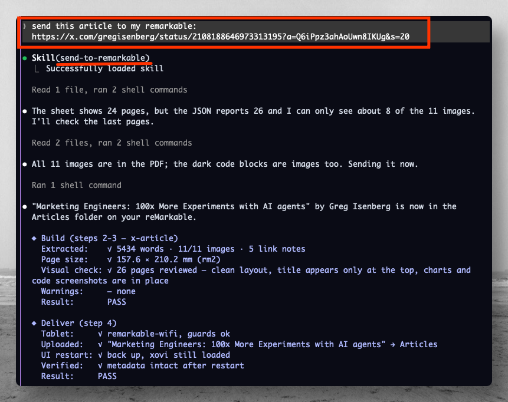
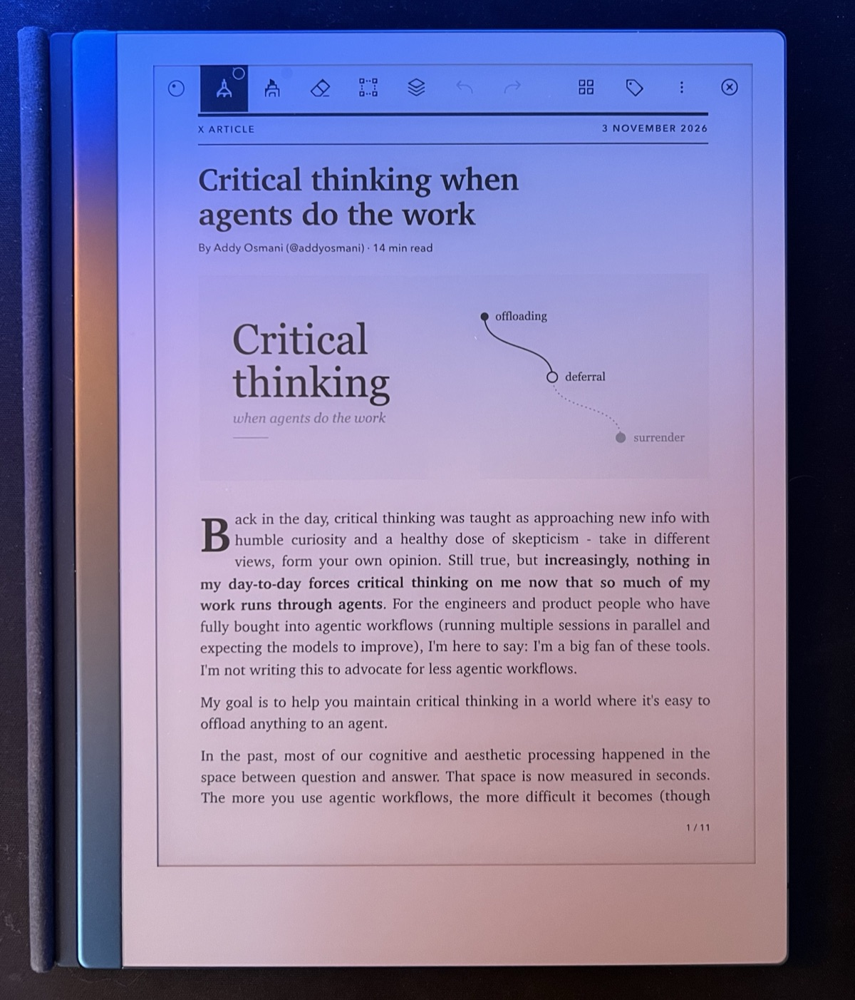
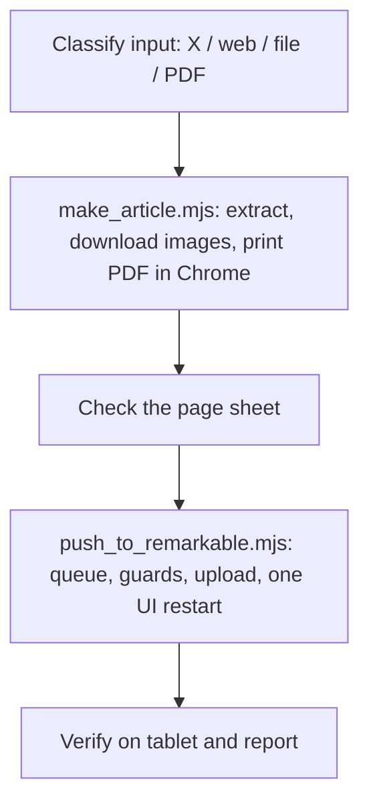

# reMarkable skills

> Send X articles, blog posts and local notes to your reMarkable as e-ink-ready PDFs, straight from your coding agent.

[](LICENSE)
[](https://github.com/luongnv89/remarkable-skills/commits/main)
[](https://github.com/luongnv89/remarkable-skills/stargazers)


Agent skills (for Claude Code and other agents that read `SKILL.md` skills) that turn what you want to read into documents on a reMarkable tablet.

| Skill | What it does |
| --- | --- |
| [`remarkable-setup`](skills/remarkable-setup/SKILL.md) | Walks you step by step from a stock tablet to one your Mac reaches over SSH (USB and Wi-Fi), with a read-only readiness probe. Run it once. |
| [`send-to-remarkable`](skills/send-to-remarkable/SKILL.md) | Turns an X article or post, a blog post, or a local `.md` / `.txt` / `.html` file into a journal-style PDF sized exactly to the tablet screen, and drops it into an `Articles` folder on the tablet. |

## What you get

- **X Articles in full**, with images and embedded posts, through the public [FxTwitter](https://github.com/FxEmbed/FxEmbed) API (no X login). Plain posts and same-author threads work too.
- **Blog posts** extracted with Mozilla Readability, with headless Chrome as a fallback for JavaScript-heavy pages. A URL that serves a PDF is passed through as is.
- **Local notes**, including Obsidian `![[image]]` embeds, plus `.txt`, saved `.html` and `.pdf` files.
- **A reader layout** made for e-ink: the exact panel size (reMarkable 2 by default; Paper Pro and Paper Pro Move as options), serif type, every image kept, links turned into numbered notes, and headings as a PDF outline.
- **Safe delivery over SSH**: one UI restart per batch; never while the reMarkdown editor is open; within the tablet's own restart limit; queued while the tablet sleeps; checked after the restart.
- **Gated setup**: every change to your Mac or the tablet is explained and needs your yes. The agent never asks for, stores or types the tablet's root password.

## Screenshots

**Send a link, and the agent does the rest.** It builds the PDF, checks every page, uploads it, restarts the tablet UI once, and confirms that the article arrived:

<p align="center">
  
</p>

**The result on the tablet:** an X Article laid out for e-ink, with serif type, a drop cap, the article's images and page numbers:

<p align="center">
  
</p>

## Requirements

- macOS with [Homebrew](https://brew.sh), Node.js 20+, Google Chrome. pandoc is needed for Markdown notes. poppler and ImageMagick are optional (all-page previews).
- A reMarkable 1 or 2, or a Paper Pro / Paper Pro Move with Developer Mode on. **Enabling Developer Mode factory-resets the tablet**, so back up first.
- Tested on a reMarkable 2 running software 3.28.

## One-prompt setup

Copy this prompt and send it to your coding agent (Claude Code or another agent that reads `SKILL.md` skills). It installs both skills, walks you through the tablet setup, and sends a test article. Keep the USB cable at hand; the agent asks before each change to your Mac or tablet.

```text
Set up my Mac so I can send web articles to my reMarkable tablet, using the skills from https://github.com/luongnv89/remarkable-skills. Do every step yourself; stop only when you need me to touch the tablet, plug in the cable, or approve a change.

1. Install the skills:
   npm install -g agent-skill-manager
   asm install github:luongnv89/remarkable-skills --all -p claude -s global -y
   (If you are not Claude Code, pick the matching -p value; run `asm install --help`.)
2. Install the Node packages of send-to-remarkable by running `npm ci` inside its scripts/ folder
   (for Claude Code: cd ~/.claude/skills/send-to-remarkable/scripts && npm ci). Do not use --prefix.
3. Read the remarkable-setup skill's SKILL.md (~/.claude/skills/remarkable-setup/SKILL.md for Claude Code)
   and follow it step by step: ask me for my tablet model and software version, run the probe,
   install missing Mac tools, set up the SSH key and the remarkable / remarkable-wifi host aliases,
   and get key login working over USB and Wi-Fi. Never ask for, store or type the tablet's root password;
   when it is needed, tell me where to find it and let me type it.
4. Run `node <send-to-remarkable>/scripts/make_article.mjs --check` and fix anything that is not ready.
5. Read the send-to-remarkable skill's SKILL.md and use it to send this test article to my tablet:
   https://paulgraham.com/greatwork.html
   Tell me when it shows up in the Articles folder.
6. Ask me whether to add this line to my global agent instructions (~/.claude/CLAUDE.md for Claude Code),
   and add it only if I say yes:
   "When I send only a URL to an article, X post or blog post, send it to my reMarkable with the send-to-remarkable skill."

When you finish, give me a short summary of what was set up and how to undo each change.
```

After that, send the agent a link (for example `https://x.com/user/status/123`) and the article lands in the `Articles` folder on your tablet. If the tablet was asleep, wake it and say "flush the reMarkable queue".

## Quick start

```sh
npm install -g agent-skill-manager                       # provides the `asm` command
asm install github:luongnv89/remarkable-skills --all -p claude -s global -y
(cd ~/.claude/skills/send-to-remarkable/scripts && npm ci)
node ~/.claude/skills/send-to-remarkable/scripts/make_article.mjs --check   # √ per tool, exit 0 when ready
```

Then, in Claude Code:

1. Run `/remarkable-setup` and follow the steps (USB cable at hand).
2. Say "send this to my reMarkable: https://x.com/user/status/123".

## Install

### With asm (recommended)

[agent-skill-manager](https://www.npmjs.com/package/agent-skill-manager) (`asm`) installs skills straight from this repo:

```sh
npm install -g agent-skill-manager

# both skills
asm install github:luongnv89/remarkable-skills --all

# or one skill
asm install github:luongnv89/remarkable-skills --path skills/send-to-remarkable
asm install github:luongnv89/remarkable-skills --path skills/remarkable-setup
```

- `-p, --tool <claude|codex|agents|all>` picks the agent; `-s, --scope <global|project>` picks the scope (asm asks if you leave it out). A global Claude Code install (`-p claude -s global`) goes to `~/.claude/skills/`.
- `asm install --help` lists every option.

`send-to-remarkable` then needs its Node packages (jsdom and Readability). Run `npm ci` inside the installed skill's `scripts/` folder, not with `--prefix` (npm 11 mishandles it):

```sh
cd ~/.claude/skills/send-to-remarkable/scripts && npm ci   # global Claude Code install
```

Installed somewhere else? `asm list --flat | grep remarkable` shows each skill's path.

### Manual install / for development

```sh
git clone https://github.com/luongnv89/remarkable-skills.git
cd remarkable-skills
mkdir -p ~/.claude/skills
ln -s "$PWD/skills/remarkable-setup"   ~/.claude/skills/remarkable-setup
ln -s "$PWD/skills/send-to-remarkable" ~/.claude/skills/send-to-remarkable
(cd skills/send-to-remarkable/scripts && npm ci)
```

`asm link ./skills -p claude` does the same linking for every skill in the checkout. With symlinks, your edits take effect in the next agent session.

Other agents: copy or link the `skills/<name>` folders into the agent's skills directory.

## Use

1. Run `/remarkable-setup` once (or ask "set up my reMarkable so I can send articles to it").
2. Send things: "send this to my reMarkable: https://x.com/user/status/123", "put this blog post on my tablet", "make ~/notes/today.md readable on my reMarkable".
3. If the tablet was asleep, the PDF waits in a queue: wake the tablet and say "flush the reMarkable queue".

Other requests the skills handle: "just make the PDF, don't send it", "what's queued for my reMarkable?", "is my tablet ready for sending articles?".

### Running the scripts directly

The agent drives these scripts, but you can run them yourself. Each prints one JSON line on stdout; progress, `Error:` and `Fix:` lines go to stderr.

```sh
S=~/.claude/skills/send-to-remarkable/scripts

node "$S/make_article.mjs" https://example.com/some-post            # build a PDF in ~/Documents/remarkable-articles/
node "$S/make_article.mjs" ~/notes/today.md --device rmpp           # Paper Pro page size
node "$S/make_article.mjs" https://example.com/js-heavy --render    # render the page in headless Chrome first

node "$S/push_to_remarkable.mjs" ~/Documents/remarkable-articles/<file>.pdf --dry-run   # plan only, writes nothing
node "$S/push_to_remarkable.mjs" ~/Documents/remarkable-articles/<file>.pdf             # queue, upload, one UI restart
node "$S/push_to_remarkable.mjs" --status    # read-only: reachability, guards, queue
node "$S/push_to_remarkable.mjs" --flush     # send what is queued

bash ~/.claude/skills/remarkable-setup/scripts/probe.sh   # read-only readiness check, exit 0 when ready
```

Push exit codes: `0` done, `3` tablet unreachable (queued), `4` reMarkdown open (queued), `5` restart budget used up (queued), `6` UI restart or check failed, `2` bad input, `1` other error. Details are in [`references/tablet.md`](skills/send-to-remarkable/references/tablet.md).

## Configuration

No config file. Defaults suit most setups; these environment variables change them. A command-line flag wins over its variable.

| Variable | Read by | Default | What it does |
| --- | --- | --- | --- |
| `RM_ARTICLES_DIR` | `make_article.mjs` | `~/Documents/remarkable-articles` | Folder for the built PDFs (the Mac copy of everything sent). Flag: `--out DIR`. |
| `RM_DEVICE` | `make_article.mjs` | `rm2` | Page size: `rm2` (reMarkable 1 and 2), `rmpp` (Paper Pro), `move` (Paper Pro Move). Flag: `--device`. |
| `CHROME_PATH` | `lib/common.mjs` | auto-detect | Browser binary for headless printing and rendering. Used only if the path exists; otherwise Chrome, Chromium, Edge and Brave in `/Applications` (and Chrome in `~/Applications`), then `PATH`, are tried. |
| `FXTWITTER_API` | `lib/x.mjs` | `https://api.fxtwitter.com` | Base URL of the FxTwitter API used for X links. |
| `RM_HOSTS` | `push_to_remarkable.mjs` | `remarkable-wifi,remarkable` | SSH host aliases to try, in order. Flag: `--hosts a,b`. |
| `RM_FOLDER` | `push_to_remarkable.mjs` | `Articles` | Top-level tablet folder (no slashes). Flag: `--folder`. |
| `RM_STATE_DIR` | `push_to_remarkable.mjs` | `~/Library/Application Support/send-to-remarkable` | Queue, pending restarts, restart log and lock. Defaults to `<RM_TABLET_DIR>.state` when a fake tablet is set. |
| `RM_TABLET_DIR` | `push_to_remarkable.mjs` | unset | Use a local folder as a fake tablet: no SSH, restart simulated. For tests and evals. |

Other flags: `make_article.mjs` takes `--render` and `--no-notes` (no numbered link notes); `push_to_remarkable.mjs` takes `--title`, `--force` (upload a second copy), `--no-restart` and `--queue-only`. `probe.sh` takes `--key` (default `~/.ssh/id_ed25519_remarkable`), `--usb` (default `remarkable`) and `--wifi` (default `remarkable-wifi`). Run any script with `--help`.

## How delivery works

The tablet's UI (`xochitl`) only reads its library at start. The push script writes the PDF and its metadata files into `/home/root/.local/share/remarkable/xochitl/`, then restarts the UI once. Before restarting, it checks that:

- the reMarkdown editor is not open (a restart would lose its unsaved text);
- the UI has not been restarted too often (xochitl allows 4 starts in 10 minutes before the tablet's failure handler can reboot it).



See [`skills/send-to-remarkable/references/tablet.md`](skills/send-to-remarkable/references/tablet.md) for the protocol, exit codes and troubleshooting.

## Project structure

```text
remarkable-skills/
├── skills/
│   ├── remarkable-setup/
│   │   ├── SKILL.md                 # agent instructions (loaded when the skill triggers)
│   │   ├── docs/README.md           # human catalog page (never loaded by the agent)
│   │   ├── references/troubleshooting.md
│   │   ├── scripts/probe.sh         # read-only readiness probe
│   │   └── evals/evals.json
│   └── send-to-remarkable/
│       ├── SKILL.md
│       ├── docs/README.md
│       ├── references/              # sources.md, layout.md, tablet.md
│       ├── scripts/
│       │   ├── make_article.mjs     # input → PDF
│       │   ├── push_to_remarkable.mjs   # PDF → tablet over SSH
│       │   └── lib/                 # x, web, local readers; renderer; shared helpers
│       ├── assets/article.css       # the reader layout
│       └── evals/                   # evals.json and an Obsidian vault fixture
├── .github/                         # issue and pull request templates
├── docs/
│   ├── images/                      # README screenshots
│   └── OSS_READINESS_CHECKLIST.md
├── CHANGELOG.md
├── CONTRIBUTING.md
├── CODE_OF_CONDUCT.md
├── SECURITY.md
└── LICENSE
```

## Documentation

- `remarkable-setup`: [overview](skills/remarkable-setup/docs/README.md) · [troubleshooting](skills/remarkable-setup/references/troubleshooting.md)
- `send-to-remarkable`: [overview](skills/send-to-remarkable/docs/README.md) · [sources](skills/send-to-remarkable/references/sources.md) (how each input is read) · [layout](skills/send-to-remarkable/references/layout.md) (page sizes, fixing a bad page) · [tablet](skills/send-to-remarkable/references/tablet.md) (push protocol, exit codes, fake tablet)
- [CHANGELOG.md](CHANGELOG.md): changes per skill version

## Contributing

Bug reports, new sources, other tablet models, layout fixes and new evals are welcome. Read [CONTRIBUTING.md](CONTRIBUTING.md) for setup, the offline smoke test (no tablet needed) and the PR process, and follow the [Code of Conduct](CODE_OF_CONDUCT.md).

## Security

`remarkable-setup` creates a passphrase-less key (`~/.ssh/id_ed25519_remarkable`) and, after your yes, runs `rm-ssh-over-wlan on`, so the tablet accepts root SSH from your Wi-Fi network: anyone there who knows the root password can log in, as over USB. `rm-ssh-over-wlan off` undoes it. Report vulnerabilities privately as described in [SECURITY.md](SECURITY.md), not in a public issue.

## Disclaimer

Not affiliated with reMarkable AS. Writing to the tablet over SSH is unsupported by reMarkable; you use these skills at your own risk. Respect the terms of the sites you read; the skills do not bypass paywalls or logins.

## License

MIT, see [LICENSE](LICENSE).

## Acknowledgments

- [FxTwitter / FxEmbed](https://github.com/FxEmbed/FxEmbed) for the public X API.
- [Mozilla Readability](https://github.com/mozilla/readability) and [jsdom](https://github.com/jsdom/jsdom) for article extraction.
- [pandoc](https://pandoc.org) for Markdown conversion, and headless Google Chrome for printing.
- The xovi, AppLoad and reMarkdown tablet extensions, whose behavior shaped the push guards.
- The [Contributor Covenant](https://www.contributor-covenant.org) for the Code of Conduct.
