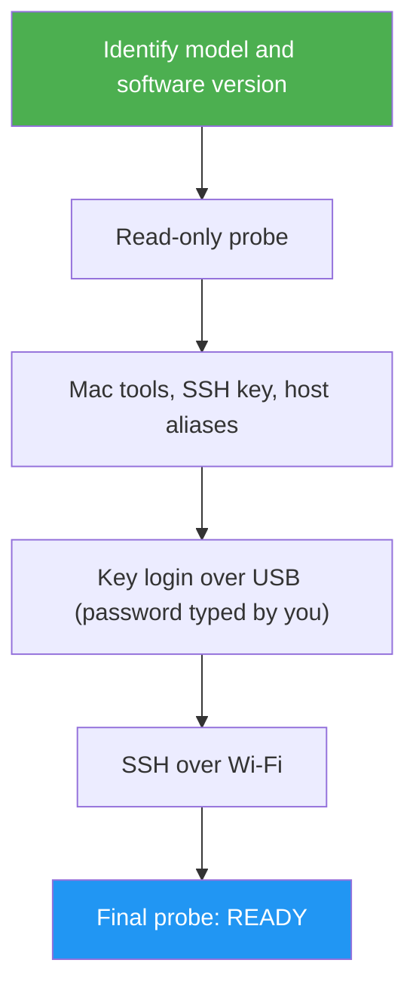

<!--
  DO NOT READ THIS FILE — This README.md is for human catalog browsing only.
  It ships inside the .skill package but is NEVER auto-loaded into agent context.
  The runtime loader only reads SKILL.md + references/ + scripts/ + agents/ when the skill triggers.
  If you're an AI agent, read the SKILL.md file instead for skill instructions.
-->

# reMarkable Setup

> Walks you, one verified step at a time, from a stock reMarkable to a tablet that `send-to-remarkable` can reach over USB and Wi-Fi.

## Highlights

- Starts with a read-only probe and does only the missing steps
- Sets up passwordless SSH: a dedicated key, `remarkable` (USB) and `remarkable-wifi` (Wi-Fi) host aliases, key install with your password typed once by you
- Turns on SSH over Wi-Fi with the tablet's own `rm-ssh-over-wlan` utility
- Checks the Mac tools (Node, Chrome, optional pandoc and preview tools) and asks before installing anything
- Warns plainly that Paper Pro / Move need Developer Mode, which factory-resets the tablet

## When to Use

| Say this... | Skill will... |
| --- | --- |
| "Set up my reMarkable so I can send articles to it" | Probe, then guide the missing steps |
| "My reMarkable doesn't connect over Wi-Fi anymore" | Probe and walk the Wi-Fi troubleshooting |
| "Is my tablet ready for sending articles?" | Run the probe and report READY / NOT READY |

## How It Works



## Usage

```
/remarkable-setup
```

## Resources

| Path | Description |
| --- | --- |
| `scripts/probe.sh` | Read-only readiness check (one line per item, plus JSON) |
| `references/troubleshooting.md` | USB link, password, host-key warnings, Wi-Fi name resolution |

## Output

A READY / NOT READY report with the probe evidence, what could not be tested (for example USB with no cable plugged in), and the next step.
