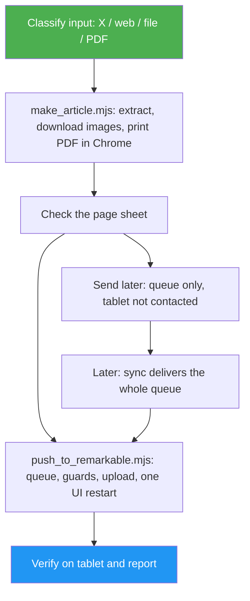

<!--
  DO NOT READ THIS FILE — This README.md is for human catalog browsing only.
  It ships inside the .skill package but is NEVER auto-loaded into agent context.
  The runtime loader only reads SKILL.md + references/ + scripts/ + agents/ when the skill triggers.
  If you're an AI agent, read the SKILL.md file instead for skill instructions.
-->

# Send to reMarkable

> Turn an X article, blog post or local text file into a reader PDF sized to the reMarkable screen, and drop it into the tablet's Articles folder over SSH, now or at a later sync when the tablet is away.

## Highlights

- Reads X Articles (full body, images, embedded posts) through the public FxTwitter API, with no X login
- Extracts blog posts with Mozilla Readability, falling back to headless Chrome for JavaScript-heavy pages; reads Markdown (Obsidian embeds included), text and saved HTML files
- Prints a journal-style PDF at the exact panel size (rM2 157.8 × 210.4 mm; Paper Pro and Move too): masthead, cover image, serif body, drop cap, every image kept, links as numbered notes, PDF outline
- Delivers over SSH with safety rails: never restarts the UI while reMarkdown is open, respects xochitl's start limit, queues when the tablet sleeps, and verifies the document after the restart
- Send now or sync later: away from the tablet, the PDF is built and checked now and waits in a queue on your Mac. Say "sync my reMarkable" when the tablet is back, and everything goes over in one UI restart, each document to its own folder

## When to Use

| Say this... | Skill will... |
| --- | --- |
| "Send this to my reMarkable: https://x.com/user/status/123" | Convert the X Article and push it to Articles |
| "Put this blog post on my tablet for tonight" | Extract the article, print the PDF, deliver it |
| "Make my note ~/vault/Reading.md readable on the reMarkable" | Convert the Markdown with its images, deliver it |
| "My reMarkable isn't with me, queue this for later: https://…" | Build and check the PDF now, queue it without contacting the tablet |
| "Sync my reMarkable" | Deliver everything queued, in one UI restart |
| "What's waiting for my reMarkable?" | List the queue from the Mac, without contacting the tablet |

## How It Works



## Usage

```
/send-to-remarkable https://x.com/addyosmani/status/2117512471930167377
```

First run: `cd ~/.claude/skills/send-to-remarkable/scripts && npm ci` (installs jsdom and Readability). Needs Node 20+, Google Chrome, and pandoc for Markdown files. SSH aliases `remarkable-wifi` / `remarkable` must reach the tablet as root.

## Resources

| Path | Description |
| --- | --- |
| `scripts/make_article.mjs` | Input → PDF (JSON summary on stdout) |
| `scripts/push_to_remarkable.mjs` | PDF → tablet over SSH, with queue and guards; `--queue-only` (send later), `--flush` (sync), `--list`, `--status`, `--dry-run` |
| `scripts/lib/` | X, web, local-file readers and the renderer |
| `assets/article.css` | The reader layout |
| `references/` | Source details, layout fixes, tablet protocol and troubleshooting |

## Output

A PDF in `~/Documents/remarkable-articles/` and the same document in the tablet's `Articles` folder, or in the queue until the next sync, plus a short report: what was delivered or queued (and why), the evidence checked, and any action left for you.
