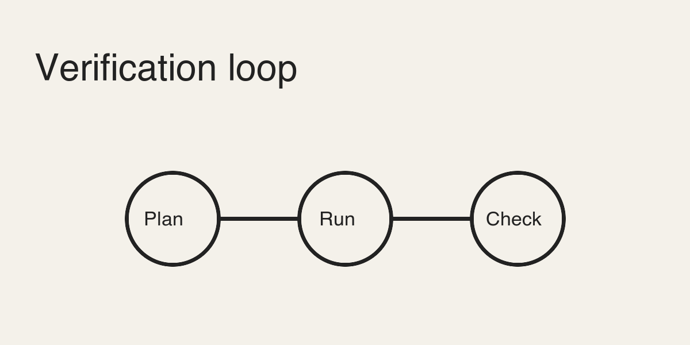

# Reading notes on agent workflows

These notes collect **key ideas** from recent reading, with an *italic aside* and a [link to the source](https://addyosmani.com/blog/cognitive-surrender/). See also [[Other note|my other note]].



## A table

| Idea | Source | Score |
| --- | --- | --- |
| Cognitive surrender | Addy Osmani | 9 |
| Comprehension debt | Margaret-Anne Storey | 8 |

## Some code

```python
def verify(output):
    assert output.tests_pass, "run the tests first"
    return output
```

> A quote block that should be indented and italic.

- [ ] a task item
- [x] a done item

An Obsidian embed from the attachments folder:

![[weekly-chart.png]]

A footnote reference.[^1]

[^1]: The footnote text.
